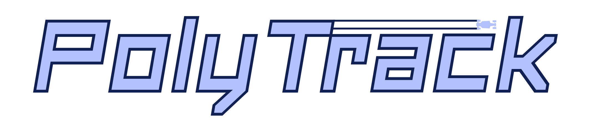

# PolyTrack Modded



Forked from [Yinnotayl/Polytrack](https://github.com/Yinnotayl/Polytrack). PolyTrack was created by [Kodub](https://www.kodub.com/). This mod includes community tracks, mobile controls, and gamepad support.

## Contents

- [Run the game](#run-the-game)
- [iPhone and iPad](#iphone-and-ipad)
- [Controls](#controls)
- [Project layout](#project-layout)

## Run the game

Keep the whole project folder together. The game uses relative paths, so you can move or rename the folder without changing its asset references.

For local play, start a web server from the folder containing `index.html`:

```sh
python -m http.server 8000
```

Then open <http://localhost:8000> in your browser. On iPhone or iPad, use Koder’s local server or another server on the device and open the address it provides. Serve the project over HTTPS when hosting it online.

Modern browsers restrict some game features when a page is opened directly with `file://`. A folder picker cannot remove those browser restrictions, so use a web server instead.

When the game is opened from a local file, localhost, or a local network address, it skips requests to the online leaderboard and replay service. Driving and local track play remain available; online leaderboard and replay features need a server that permits those requests.

## iPhone and iPad

To add the game to the Home Screen, open its HTTPS address in Safari, tap **Share**, then **Add to Home Screen**. The pages include an app icon and Apple standalone display metadata.

The service worker is stored in `main/`. Since it cannot control the root `index.html` from that subfolder, offline PWA caching is not active in this layout.

### iOS 12

iOS 12 Safari can add a website to the Home Screen, but it cannot run this game bundle: the bundle uses newer JavaScript syntax that iOS 12 cannot parse. The game therefore requires a newer browser. iOS 12 also does not provide a reliable folder picker for loading `data/` from a local page.

## Controls

### Keyboard

| Action | Keys |
| --- | --- |
| Accelerate | `W` or `↑` |
| Brake or reverse | `S` or `↓` |
| Steer | `A` / `D` or `←` / `→` |
| Restart | `R` or `Enter` |

### Track editor

| Action | Input |
| --- | --- |
| Place a piece | Left mouse button |
| Rotate the view | Middle mouse button and drag |
| Pan the view | Right mouse button and drag |
| Zoom | Mouse wheel |
| Adjust height | `Shift` and mouse wheel, or `Z` / `C` |
| Rotate a piece | `R` or `Space` |
| Delete a piece | `X` |
| Test the track | `T` |

Touch gestures and controls depend on the device and browser.

### Mobile controls

In **Settings → Mobile Controls**, **Left-handed controls** is off by default. Acceleration and braking are on the right, and steering is on the left. Turn the option on to switch sides. The choice is saved in browser storage for the current site.

### Game controller

Open **Settings → Game Controller** to change bindings. Click either binding button for an action, then press a controller button or move a stick. The two slots allow two inputs for each action.

Default racing controls:

| Action | Xbox-style | PlayStation-style |
| --- | --- | --- |
| Steer | Left stick | Left stick |
| Brake | LT | L2 |
| Accelerate | RT | R2 |
| Restart | View | Share |

In menus, use the D-pad to move the white focus outline, **A / Cross** to select, and **B / Circle** to go back. Vibration is off by default. The analog test meters show live stick and trigger values when a controller is connected.

## Project layout

| Path | Purpose |
| --- | --- |
| `index.html` | Main game page |
| `data/` | Tracks, images, fonts, and other game assets |
| `data/cursor/` | Tailless cursor files |
| `java/` | Runtime bundles, simulation worker, and controller support |
| `main/` | Web app manifest and service worker |
| `README.md` | This guide |

The runtime bundles are compiled game code. If you replace an asset in `data/`, keep its existing filename and subfolder so the game can find it.
